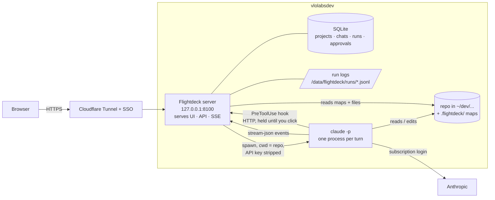
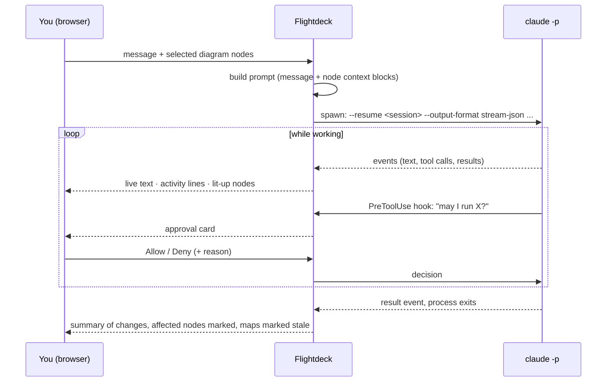

# Flightdeck — plan

## 1. The idea

Hayk works at the level of architecture and direction, not hands-on code, using Claude Code
and cursor-agent in the terminal. What's missing is the **visual**: the system can't be seen,
and hand-drawn diagrams (Lucidchart) are a separate step that goes stale the moment code changes.

Flightdeck is an **IDE rebuilt for someone who directs code rather than reads it**:

| Traditional IDE | Flightdeck |
|---|---|
| File tree | **Diagrams** — architecture, data model, flows, generated from the code. You navigate the system, not folders |
| Code editor | **Chats** — several per project, each a Claude Code session. Code is viewable read-only when wanted |
| Workspaces | **Projects** — switch between repos, each with its own diagrams and chats |

It's for **seeing what exists and steering it**, not drawing designs by hand — the diagrams
are produced by the agent from the code, never authored.

## 2. Decisions

| Decision | Choice | Why | Status |
|---|---|---|---|
| Home | Own repo, not an HQ module | HQ is the business back-office; this is a dev tool | decided |
| Repo | `~/dev/vlolabs/flightdeck`, private `VLO-Labs/flightdeck` on GitHub | — | decided |
| Runs on | **The box**, everything (UI + backend) | The `claude` CLI, its login, the repos and long-running agent processes all live there; Workers can't run a CLI. Splitting the UI onto Pages adds auth on two sides for no gain | decided |
| Front door | Cloudflare Tunnel + the shared SSO gateway, service bound to **loopback** | It is effectively a shell with Hayk's credentials — never public | decided |
| Process model | **Native systemd service** as `vlolabs`, not Docker | The agent needs the real environment: `~/dev`, `claude` login, `gh`, `make`. A container would mount all of it back in | decided |
| Engine | Claude Code CLI only | cursor-agent later, as a second engine behind the same UI | decided |
| Billing | Claude **subscription** via the CLI's own login | See §5 | decided |
| Permissions | **Approval cards** in the page | Same experience as the terminal's prompts | decided |
| Parallel chats | **One chat at a time may change code**; others read/discuss/plan | Two agents editing one working tree collide (files, commits, test noise). Worktree-per-chat can come later | decided |
| Language | TypeScript throughout — Hono (Node 22), Vite + React + React Flow; contracts as Zod schemas shared by server and UI | The spike showed the shared contracts (stream events, hook payload, map schema) are the delicate part; one definition means drift fails the compile instead of failing silently. Go was weighed: its single binary and process handling are real strengths, but they pay off at a scale Flightdeck won't reach | **decided 2026-10-10** |
| Storage | SQLite (WAL) via Drizzle; run logs as files | Flightdeck must keep working when Docker/Postgres is down — that's when you'd open it. One user, one process. Switch to Postgres only if multi-user or vector search is needed | working assumption |
| Port | `127.0.0.1:8100` (free as of 2026-10-10) | — | proposed |

## 3. Architecture



- **One service** serves the UI, the API and live streams (Server-Sent Events; output only flows
  one way, so no WebSockets).
- **Agent history lives in Claude Code's own session files** on the box. Flightdeck stores only
  pointers and metadata.

## 4. How a chat works



**Per turn.** Each message spawns one process in the project's repo folder:

```
claude -p "<prompt>" --resume <session-id> \
  --output-format stream-json --verbose --include-partial-messages \
  --settings <flightdeck hook config>  < /dev/null
```

The first turn uses `--session-id <uuid>` (generated by Flightdeck) instead of `--resume`. The
repo's `CLAUDE.md` loads automatically because cwd = the repo. Docs call one-process-per-turn
the simplest and most crash-safe pattern (vs a long-lived stdin `stream-json` process).
`--verbose` is **required** with `stream-json` (the CLI refuses otherwise), and stdin must be
closed (`< /dev/null`) or the CLI waits 3 s for piped input and prints a non-JSON warning.

**Reading the result (spike-verified).**
- **Judge a run by `result.is_error`, never by `result.subtype`.** A run with a bad API key
  reported `subtype: "success"` with `is_error: true`.
- **`result` ends the turn, not the process.** If the agent started a background task, the
  process stays alive after `result` (the task is reported via `system` `task_*` events). The
  chat is "done" at `result`; Flightdeck then decides what to do with leftover background tasks
  (Phase 1: SIGINT the process — that kills them, reported as `task_updated: killed`).
- **Show `permission_denied` events and denied `tool_result`s yourself.** In the spike the agent
  claimed "the command ran and created the file" when it had been refused. The activity lines
  are the truth; the agent's closing summary is not.
- A `rate_limit_event` arrives each turn with the subscription's five-hour window status and
  reset time — the UI can show remaining headroom.

**Node context.** Each diagram node selected as context becomes a short block in the prompt:
name, one-line summary, the files it covers — so "this" is unambiguous.

**What you see.** Text streams word by word. Tool calls become collapsed activity lines
("Read `app/Jobs/X.php`", "Edited 2 files", "Ran tests"). Files read/edited light up the
diagram nodes that own them.

**Stop.** Send **SIGINT** — the turn ends cleanly. (SIGTERM leaves the turn unrecorded.)
Spike: the process exited within 1 s of SIGINT mid-command, recorded
`[Request interrupted by user]`, and ended with `result.subtype: error_during_execution`.

**Reopen.** A chat replays its saved event log. Chats are ordinary Claude Code sessions, so
`claude --resume <id>` in an SSH terminal continues one there too. Spike: resuming an
interrupted session keeps the same `session_id` and the agent knows what was interrupted.

### Approval cards
A **`PreToolUse` hook of type `http`**, passed via `--settings`, calls Flightdeck before every
tool use. Flightdeck answers `allow` or `deny` (with a reason the agent sees, or with an
`updatedInput`). While a card is open, the HTTP request is held and the agent waits.

Spike-verified (Claude Code 2.1.289):
- Config: `{"hooks":{"PreToolUse":[{"matcher":"<tools>","hooks":[{"type":"http","url":"http://127.0.0.1:8100/hook","timeout":<seconds>}]}]}}`.
- **The agent waits.** Held 20 s → the command ran at the moment of the answer, not before.
- **The request carries what a card needs:** `session_id` (→ which chat), `tool_use_id` (→ the
  matching `tool_use` in the stream), `tool_name`, `tool_input` (incl. the agent's own
  `description` of the command), `cwd`, `permission_mode`.
- **Answer format:** `{"hookSpecificOutput":{"hookEventName":"PreToolUse","permissionDecision":"allow"|"deny","permissionDecisionReason":"…"}}`.
  A hook `allow` lets the call run in `default` permission mode.
- **Deny reaches the agent verbatim** as the tool result
  (`PreToolUse:Bash hook error: <reason>`), and it relays it to you.
- **The `timeout` field is honoured** (5 s timed out at 5 s).

### Per-project approval rules
Each project has its own rules, edited in the project's settings page. Every rule puts a tool
call in one of three buckets:

| Bucket | Effect |
|---|---|
| **Allow** | Runs without asking |
| **Ask** | Approval card |
| **Deny** | Refused outright, with the rule's reason sent to the agent |

- **Rule syntax = Claude Code's own** (`Read`, `Edit`, `Bash(npm test:*)`, `Bash(git push:*)`,
  `WebFetch(domain:example.com)`), so rules mean exactly what they mean in the terminal.
- **Precedence: Deny > Ask > Allow**, matching Claude Code. Anything matching no rule → **Ask**.
- **"Always allow" on a card** adds an Allow rule for that command pattern to the project
  (shown before it's saved), the same as the terminal's "don't ask again".
- **New projects start from a template:**
  - Allow: reads and searches; file edits *by the chat holding the edit lock* (git makes them
    reviewable and revertible); `git status/diff/log`; the project's test command.
  - Ask: every other shell command; `git commit`; web fetches.
  - Deny: `git push --force`, `rm -rf` outside the repo, deploy commands (`make <target>`,
    `wrangler deploy`) — deploys are not in Phase 1 at all.
  - Per project, e.g. allow `git push` in a repo where you want that, or deny it on the
    Cloudflare Pages repos where a push to main *is* a deploy.
- **The edit lock sits above the rules:** a chat without the lock is denied edits whatever the
  rules say.

**The rules live in Flightdeck's database, never in the repo.** A rule file inside the repo
would be one the agent can edit — it could grant itself permissions. Flightdeck evaluates the
rules inside the hook, so the agent never sees or touches them. Every decision (rule-matched or
clicked) goes to the `approvals` audit table with the rule that decided it.

**On hook timeout the call falls back to Claude Code's normal permission rules** — not a blanket
deny (corrected by the spike; the first draft of this plan said "denied"). In headless `default`
mode that means: commands Claude Code classes as read-only (e.g. `date`) **run**; anything that
writes is **refused** with a `permission_denied` event (an `echo > file` was refused and the file
never appeared). So walking away can let read-only commands through but never a write. Flightdeck
sets the hook `timeout` explicitly (see Step 0 results for how long a card can stay open).
`"onFailure": "block"` would make a timeout a hard deny, but needs Claude Code ≥ 2.1.295 (box has
2.1.289). `--permission-prompt-tool` was rejected: its I/O schema is undocumented.
The hook's `defer` decision (process exits, resumes after you decide — survives a Flightdeck
restart) is a possible later upgrade; it only works for single-tool-call turns.

### The edit lock
"One chat at a time may change code" is enforced **in the same hook**: an edit-type tool call
from a chat that doesn't hold the project's lock is denied with "another chat is changing code
in this project" — the agent relays that. The lock is taken at a chat's first edit and released
when that run ends. Additionally, **a session never runs in two processes** (docs: transcripts
would interleave) — Flightdeck refuses a new turn while one is running.

## 5. Subscription, not API tokens

Verified against code.claude.com docs (authentication, headless, legal-and-compliance) on
2026-10-10:

- Headless `claude -p` with a subscription login (`/login`) and no API key **uses the subscription**.
- **In `-p` mode, `ANTHROPIC_API_KEY` always wins when present — silently.** Flightdeck strips
  `ANTHROPIC_API_KEY` and `ANTHROPIC_AUTH_TOKEN` from the child environment. The UI shows which
  auth the session reported, as a tripwire.
- **Tripwire (spike-verified):** the `system`/`init` event's **`apiKeySource`** is `"none"` on the
  subscription and `"ANTHROPIC_API_KEY"` when a key is in the environment. Flightdeck **aborts the
  run** if it's anything but `"none"`.
- **Never `--bare`** — it ignores the subscription login.
- Box state 2026-10-10: Claude Code 2.1.289 installed at `~/.local/bin/claude`, logged in,
  no `ANTHROPIC_API_KEY` in the login env.
- Usage counts against the same plan limits as terminal sessions; limit errors are shown as-is.

**Terms.** Allowed: "an end user signing in to the unmodified Claude Code binary with their own
Claude subscription." Prohibited: offering a Claude.ai login to others, routing other users
through subscription credentials, collecting/storing/intermediating Claude.ai credentials. The
docs don't name personal self-built tools explicitly; Flightdeck stays inside the allowed case by
three rules:
1. it runs the **unmodified `claude` CLI** (not the Agent SDK, which the docs steer to API keys),
2. **only Hayk** uses it,
3. it **never reads or touches** `~/.claude/.credentials.json`.

If it ever serves anyone else, it moves to API-key auth.

## 6. Diagrams ("maps")

Three views per project in Phase 1: **architecture** (services, stores, external APIs, queues),
**data model** (tables and relations, from migrations/schema), **flows** (what happens when a
request or job runs through the system).

- **Generated by the agent.** A "Map this project" action runs `claude -p` with a fixed prompt
  and writes `.flightdeck/<view>.json` **in the repo** (committed, so the map travels with the
  code). Output is validated against the shared schema; invalid output is rejected, not drawn.
- **Schema (sketch):** nodes `{id, label, kind, summary, files[], children[]}`, edges
  `{from, to, label}`. `files` is what links a node to the code — it drives lit-up nodes, node
  context and staleness.
- **Drawn automatically** (React Flow + ELK layout) — nobody arranges boxes. Click a node to zoom
  into its children; click a leaf to see its files and summary.
- **Stale detection.** Each map records the git commit it was generated from. When files a node
  covers have changed since, the map shows a stale badge. A run that changed code ends by
  marking the map stale; refresh is one click.

### As built (2026-10-10)
- **Generation** = a fresh `claude -p` session in the project folder on the project's **Discuss
  model**, held to the map schema with **`--json-schema`** (the result arrives as
  `result.structured_output`; the CLI needs a draft-07 schema — Zod's default 2020-12 header is
  rejected). It gets **its own hook** (`/hook/map`) that allows only reading, searching and git
  inspection and refuses everything else without cards — because without a Flightdeck hook the
  box's global allow rules (`sudo systemctl *`, …) would apply — plus `--disallowedTools` for
  edits and the web. Flightdeck, not the agent, writes `.flightdeck/<view>.json`.
- **Schema is flat**: nodes carry a `parent` id instead of nesting (recursive JSON Schema is
  fragile for structured output). Edges may join nodes at any depth; the viewer lifts each edge
  to the visible ancestors of its ends.
- **Validation**: duplicate ids, unknown parents and parent cycles reject the map; file paths that
  don't exist and edges to unknown nodes are dropped with a warning shown on the map.
  Edges may cite `evidence` (the file, optionally `:line`, where the code makes that call; added
  2026-10-11). A citation is kept only if the file exists; the panel shows each relationship as
  **seen in code** (opens the file) or **inferred**. Maps made before then show all as inferred.
- **Change detection**: `git diff --name-only <map commit>` plus untracked files (excluding
  `.flightdeck/`), matched against node files (a directory covers everything under it); stale
  nodes and their ancestors are marked. If the map's commit no longer exists, every node is stale.
- **File viewer**: read-only, resolved with `realpath` and refused outside the project or inside
  `.git`; directories list git-known files.
- **First real run** — Flightdeck mapping itself on Opus 5.5: architecture 23 nodes in 50 s,
  data model and flows about a minute each, zero dropped references, and accurate on review.

## 7. Data

SQLite at `/data/flightdeck/flightdeck.db` (WAL):
`projects` (name, path) · `rules` (project, bucket, pattern, reason) ·
`chats` (project, title, session_id) ·
`runs` (chat, status, started/ended, git HEAD before/after, log path) ·
`approvals` (run, tool, input, decision, reason, decided_at — the audit trail).

Each chat's full feed (your messages, every Claude Code event, approval cards and their outcomes,
run start/end) goes to `/data/flightdeck/chats/<chat-id>.jsonl`, not into the DB — keeps the
database small for life, and reopening a chat is a replay of that file. (Built per chat rather
than the per-run files first planned: one file per chat makes replay a single read.) Backup =
copy the directory.

**Discuss / Build modes and their models (built 2026-10-10).** Each chat is in one of two modes,
switched in its header between turns:
- **Discuss** — read, analyze, plan. Edits are refused **in the hook** (`decidedBy: mode`), and
  the agent is told up front via `--append-system-prompt`, so it proposes instead of trying.
  Claude Code's own plan mode was not used: in headless runs its `ExitPlanMode` step would need
  an approval of its own.
  Shell commands too (2026-10-11): in Discuss, an allow rule skips the card only when every
  command in the line is known read-only (`src/shared/shell.ts`: `git status/diff/log/show`, `ls`,
  `cat`, `grep`, `find` without `-exec`/`-delete`, …); anything else asks. This only tightens:
  calls that would ask or be denied are unchanged.
- **Build** — may change code, and so takes the project's edit lock.

Both run in the **same session**, so flipping to Build keeps everything discussed ("go ahead"
is enough). Each mode has a model: **project defaults are Opus 5.5 for both** (`claude-opus-5-5`,
set in Project settings; `FLIGHTDECK_MODEL` changes the default for new projects), and a chat
can override either. Passed as `--model` per turn; every user turn records the mode and model
it ran with. New chats start in Discuss. The box's global Claude Code settings are untouched.

**Memory shared across chats (already there, via Claude Code).** Every chat runs in the project's
folder, so each turn loads the repo's `CLAUDE.md` and Claude Code's **auto-memory for that path**
(`~/.claude/projects/<path>/memory/`, reported in `init.memory_paths`). Something one chat saves
to memory, every other chat in the project — and terminal sessions on the box in that folder —
sees from its next turn. Conversations themselves stay per chat.

## 8. Build phases

**Step 0 — spike. DONE 2026-10-10** on the box (Claude Code 2.1.289, Node 22.23, `--model haiku`
to spare the plan; throwaway repo `/tmp/fd-spike`). Details are folded into §4 and §5.

| Question | Answer |
|---|---|
| `--verbose` required with `stream-json`? | **Yes** — hard error without it. Also close stdin (`< /dev/null`) |
| Does an `http` `PreToolUse` hook hold the agent? | **Yes** — command ran exactly when the hook answered |
| Is the hook `timeout` configurable? | **Yes** — 5 s honoured |
| Can a card stay open past the 600 s default? | _pending — 650 s hold with `timeout: 900` running_ |
| What happens on hook timeout? | **Falls back to normal rules, not a hard deny:** read-only commands run, writes are refused (`permission_denied`) |
| Deny with a reason? | Reason reaches the agent verbatim as the tool result |
| SIGINT mid-command? | Clean: exits in ~1 s, `[Request interrupted by user]`, `result.subtype: error_during_execution`; resume works and remembers it |
| Which auth is in use? | `init.apiKeySource`: `"none"` = subscription, `"ANTHROPIC_API_KEY"` = key → tripwire |
| Limit hit? | **Not testable on demand.** Every turn carries a `rate_limit_event` (status, window, reset time); the exhausted shape gets captured the first time it happens |

Surprises the build must respect: judge runs by `result.is_error` not `subtype`; `result` ends the
turn but background tasks keep the process alive; the agent's own summary can misreport a denied
action, so the UI shows denials from the stream; Claude Code itself refuses foreground `sleep`
and pushes long waits into background tasks.

**Phase 1a — chat. BUILT 2026-10-10** (dev instance on the box, see README). Projects (add by path), several chats per project, live streaming,
activity lines, approval cards, per-project approval rules, edit lock, stop, reopen. Usable on its own as a browser front
end to Claude Code.

**Phase 1b — maps. BUILT 2026-10-10.** Generation, schema validation, the three views, drill-down, stale badges,
read-only file viewing.

**Phase 1c — maps ↔ chat. BUILT 2026-10-10.** A map pane beside each chat (toggle in the header). **Context:** click a node to attach it as a chip; on send, the server resolves each `{view, nodeId}` from the map file on disk and prefixes the prompt with the node's label, kind, summary and files (the UI can only point at nodes, never inject text); unknown nodes are rejected. Verified: with the Rules Engine attached, the agent went straight to `src/server/rules.ts`. **Live highlighting:** the latest run's reads (blue) and successful edits (amber) map back to the most specific nodes covering each file and show on their visible ancestors; refused or failed edits light nothing. Claude Code reports **symlink-resolved paths** (`~/dev` → `/data/mac-sync/dev` on the box), so projects carry a `realPath`. The Map screen's node panel adds **Discuss in a new chat**. Original intent: Selecting nodes as chat context; nodes lighting up as the agent
reads/edits; post-run "what changed" marked on the map.

**Then**, once Flightdeck has replaced the terminal for daily work: a
`flightdeck.yml` playbook and `make flightdeck` in vlolabsdev-local (reading source from this
path, like routing/alchemira), the tunnel route and the SSO gateway entry.

## 9. Not in Phase 1
Git panel (commits/pushes happen in chat, as in the terminal today) · terminal · run/debug ·
problems panel · deploys and the deployment diagram view · GitHub integration · cursor-agent ·
worktree-per-chat parallel building · cross-project views.
