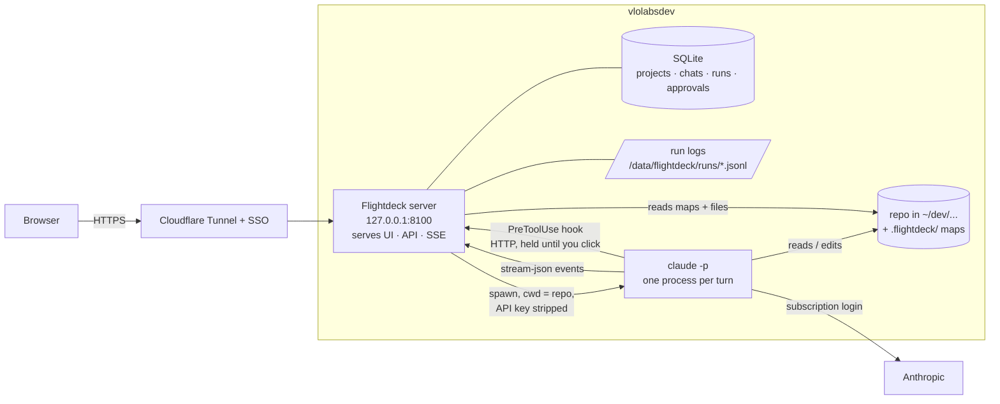
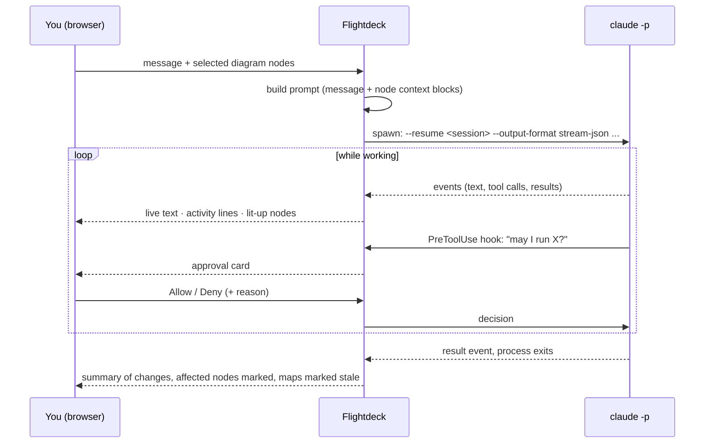

# Flightdeck — plan

## 1. The idea

Hayk works at the level of architecture and direction, not hands-on code, using Claude Code
and cursor-agent in the terminal. What's missing is the **visual**: the system can't be seen,
and hand-drawn diagrams (Lucidchart) are a separate step that goes stale the moment code changes.

Flightdeck is an **IDE rebuilt for someone who directs code rather than reads it**:

| Traditional IDE | Flightdeck |
|---|---|
| File tree | **Diagrams** — architecture, data model, flows, generated from the code. You navigate the system, not folders |
| Code editor | **Chats** — several per project, each a Claude Code session. Code is viewable read-only when wanted |
| Workspaces | **Projects** — switch between repos, each with its own diagrams and chats |

It's for **seeing what exists and steering it**, not drawing designs by hand — the diagrams
are produced by the agent from the code, never authored.

## 2. Decisions

| Decision | Choice | Why | Status |
|---|---|---|---|
| Home | Own repo, not an HQ module | HQ is the business back-office; this is a dev tool | decided |
| Repo | Local `~/dev/vlolabs/flightdeck`; GitHub only if it succeeds | — | decided |
| Runs on | **The box**, everything (UI + backend) | The `claude` CLI, its login, the repos and long-running agent processes all live there; Workers can't run a CLI. Splitting the UI onto Pages adds auth on two sides for no gain | decided |
| Front door | Cloudflare Tunnel + the shared SSO gateway, service bound to **loopback** | It is effectively a shell with Hayk's credentials — never public | decided |
| Process model | **Native systemd service** as `vlolabs`, not Docker | The agent needs the real environment: `~/dev`, `claude` login, `gh`, `make`. A container would mount all of it back in | decided |
| Engine | Claude Code CLI only | cursor-agent later, as a second engine behind the same UI | decided |
| Billing | Claude **subscription** via the CLI's own login | See §5 | decided |
| Permissions | **Approval cards** in the page | Same experience as the terminal's prompts | decided |
| Parallel chats | **One chat at a time may change code**; others read/discuss/plan | Two agents editing one working tree collide (files, commits, test noise). Worktree-per-chat can come later | decided |
| Language | TypeScript throughout — Hono (Node 22), Vite + React + React Flow | One language → the map schema and stream-event types are shared between server and UI, so drift is caught by the compiler, not by reading code | **working assumption, not locked** |
| Storage | SQLite (WAL) via Drizzle; run logs as files | Flightdeck must keep working when Docker/Postgres is down — that's when you'd open it. One user, one process. Switch to Postgres only if multi-user or vector search is needed | working assumption |
| Port | `127.0.0.1:8100` (free as of 2026-10-10) | — | proposed |

## 3. Architecture



- **One service** serves the UI, the API and live streams (Server-Sent Events; output only flows
  one way, so no WebSockets).
- **Agent history lives in Claude Code's own session files** on the box. Flightdeck stores only
  pointers and metadata.

## 4. How a chat works



**Per turn.** Each message spawns one process in the project's repo folder:

```
claude -p "<prompt>" --resume <session-id> \
  --output-format stream-json --verbose --include-partial-messages \
  --settings <flightdeck hook config>
```

The first turn uses `--session-id <uuid>` (generated by Flightdeck) instead of `--resume`. The
repo's `CLAUDE.md` loads automatically because cwd = the repo. Docs call one-process-per-turn
the simplest and most crash-safe pattern (vs a long-lived stdin `stream-json` process).

**Node context.** Each diagram node selected as context becomes a short block in the prompt:
name, one-line summary, the files it covers — so "this" is unambiguous.

**What you see.** Text streams word by word. Tool calls become collapsed activity lines
("Read `app/Jobs/X.php`", "Edited 2 files", "Ran tests"). Files read/edited light up the
diagram nodes that own them.

**Stop.** Send **SIGINT** — the turn ends cleanly. (SIGTERM leaves the turn unrecorded.)

**Reopen.** A chat replays its saved event log. Chats are ordinary Claude Code sessions, so
`claude --resume <id>` in an SSH terminal continues one there too.

### Approval cards
A **`PreToolUse` hook of type `http`**, passed via `--settings`, calls Flightdeck before every
tool use. Flightdeck answers `allow` or `deny` (with a reason the agent sees, or with an
`updatedInput`). While a card is open, the HTTP request is held and the agent waits.

Default policy (per project, adjustable):
- **Auto-allow:** reads, searches, file edits in the chat holding the edit lock (git makes them
  reviewable and revertible).
- **Card:** shell commands not on the project's allowlist, anything else.
- **Never offered:** deploy commands — deploys are not in Phase 1 at all.

On hook timeout (default 600 s) the headless run gets **no prompt host, so the action is
denied** — walking away means the agent stops and says it was blocked, never that something
runs unapproved. `--permission-prompt-tool` was rejected: its I/O schema is undocumented.
The hook's `defer` decision (process exits, resumes after you decide — survives a Flightdeck
restart) is a possible later upgrade; it only works for single-tool-call turns.

### The edit lock
"One chat at a time may change code" is enforced **in the same hook**: an edit-type tool call
from a chat that doesn't hold the project's lock is denied with "another chat is changing code
in this project" — the agent relays that. The lock is taken at a chat's first edit and released
when that run ends. Additionally, **a session never runs in two processes** (docs: transcripts
would interleave) — Flightdeck refuses a new turn while one is running.

## 5. Subscription, not API tokens

Verified against code.claude.com docs (authentication, headless, legal-and-compliance) on
2026-10-10:

- Headless `claude -p` with a subscription login (`/login`) and no API key **uses the subscription**.
- **In `-p` mode, `ANTHROPIC_API_KEY` always wins when present — silently.** Flightdeck strips
  `ANTHROPIC_API_KEY` and `ANTHROPIC_AUTH_TOKEN` from the child environment. The UI shows which
  auth the session reported, as a tripwire.
- **Never `--bare`** — it ignores the subscription login.
- Box state 2026-10-10: Claude Code 2.1.289 installed at `~/.local/bin/claude`, logged in,
  no `ANTHROPIC_API_KEY` in the login env.
- Usage counts against the same plan limits as terminal sessions; limit errors are shown as-is.

**Terms.** Allowed: "an end user signing in to the unmodified Claude Code binary with their own
Claude subscription." Prohibited: offering a Claude.ai login to others, routing other users
through subscription credentials, collecting/storing/intermediating Claude.ai credentials. The
docs don't name personal self-built tools explicitly; Flightdeck stays inside the allowed case by
three rules:
1. it runs the **unmodified `claude` CLI** (not the Agent SDK, which the docs steer to API keys),
2. **only Hayk** uses it,
3. it **never reads or touches** `~/.claude/.credentials.json`.

If it ever serves anyone else, it moves to API-key auth.

## 6. Diagrams ("maps")

Three views per project in Phase 1: **architecture** (services, stores, external APIs, queues),
**data model** (tables and relations, from migrations/schema), **flows** (what happens when a
request or job runs through the system).

- **Generated by the agent.** A "Map this project" action runs `claude -p` with a fixed prompt
  and writes `.flightdeck/<view>.json` **in the repo** (committed, so the map travels with the
  code). Output is validated against the shared schema; invalid output is rejected, not drawn.
- **Schema (sketch):** nodes `{id, label, kind, summary, files[], children[]}`, edges
  `{from, to, label}`. `files` is what links a node to the code — it drives lit-up nodes, node
  context and staleness.
- **Drawn automatically** (React Flow + ELK layout) — nobody arranges boxes. Click a node to zoom
  into its children; click a leaf to see its files and summary.
- **Stale detection.** Each map records the git commit it was generated from. When files a node
  covers have changed since, the map shows a stale badge. A run that changed code ends by
  marking the map stale; refresh is one click.

## 7. Data

SQLite at `/data/flightdeck/flightdeck.db` (WAL):
`projects` (name, path) · `chats` (project, title, session_id) ·
`runs` (chat, status, started/ended, git HEAD before/after, log path) ·
`approvals` (run, tool, input, decision, reason, decided_at — the audit trail).

Full event streams go to `/data/flightdeck/runs/<run-id>.jsonl`, not into the DB — keeps the
database small for life. Backup = copy the directory.

## 8. Build phases

**Step 0 — spike (≈1 hour, on the box). Answers what the docs left open before anything is built:**
- Is `--verbose` required with `--output-format stream-json`?
- Does an `http` `PreToolUse` hook passed via `--settings` hold the agent while the HTTP request
  is pending, and can its timeout be raised past 600 s?
- What does the stream look like for a denied tool, an interrupted turn (SIGINT), and a limit hit?
- Does the `init` event say which auth is in use (for the tripwire)?

**Phase 1a — chat.** Projects (add by path), several chats per project, live streaming,
activity lines, approval cards, edit lock, stop, reopen. Usable on its own as a browser front
end to Claude Code.

**Phase 1b — maps.** Generation, schema validation, the three views, drill-down, stale badges,
read-only file viewing.

**Phase 1c — maps ↔ chat.** Selecting nodes as chat context; nodes lighting up as the agent
reads/edits; post-run "what changed" marked on the map.

**Then** the repo goes to GitHub if Flightdeck has replaced the terminal for daily work, plus a
`flightdeck.yml` playbook and `make flightdeck` in vlolabsdev-local (reading source from this
path, like routing/alchemira), the tunnel route and the SSO gateway entry.

## 9. Not in Phase 1
Git panel (commits/pushes happen in chat, as in the terminal today) · terminal · run/debug ·
problems panel · deploys and the deployment diagram view · GitHub integration · cursor-agent ·
worktree-per-chat parallel building · cross-project views.
